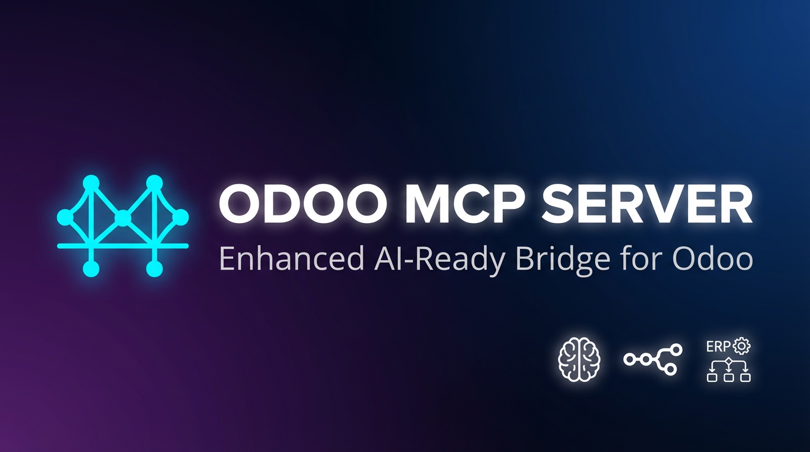
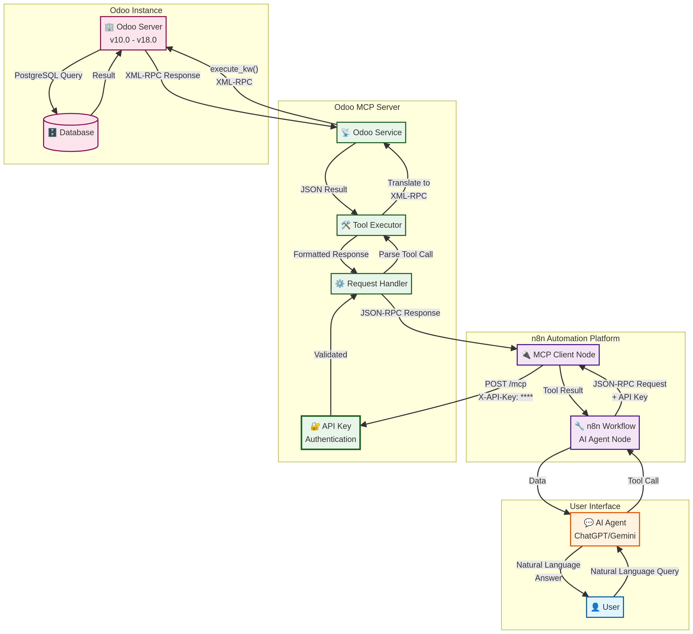

# Odoo MCP Server (Enhanced for AI Agents)



[](https://opensource.org/licenses/MIT)
[](https://www.python.org/downloads/)
[](https://www.docker.com/)
[](https://www.odoo.com/)
[](https://modelcontextprotocol.io/)

---

## Introduction

**Odoo MCP Server** is a [Model Context Protocol](https://modelcontextprotocol.io/) server that connects AI agents (Claude Code, Claude, ChatGPT, n8n, …) to any Odoo database, from Odoo 10 to Odoo 20.

It speaks **XML-RPC to Odoo 18 and older** and Odoo's **JSON-2 API to Odoo 19 and newer**, picking the right one automatically. XML-RPC is deprecated in Odoo 19 and will be removed in Odoo 22. Responses are kept small and readable for language models: records are paginated, and binaries are summarised instead of sent. Long text is cut, Arabic and other non-Latin text stays as plain UTF-8, and metadata comes back as compact tables.

Odoo connections, API keys and admin accounts are all managed in a built-in **web admin UI**. Nothing sensitive goes in environment files.

### Key features

- **Dual transport:** auto-detects the Odoo version and uses JSON-2 on 19+ and XML-RPC on 18 and older; it can be forced per connection.
- **AI-friendly output:** small defaults, paginated search, binary summaries, a 100 KB response guard and compact JSON.
- **13 tools** with MCP annotations (read-only / destructive hints), including `get_context`, `aggregate` and `name_search`.
- **Context-aware:** the user, time zone and language, plus multi-company and branch control on every tool.
- **Standards-compliant MCP:** protocol versions 2024-11-05 to 2025-11-25, tool errors returned as `isError` results, `structuredContent`, batching and notifications.
- **Web admin UI:** connections with a step-by-step connection test, API keys with read-only or read-write scope, and a dashboard with per-tool response sizes.
- **Secure by design:** Odoo credentials are Fernet-encrypted at rest; every MCP request needs an API key; browser origins are blocked unless allowed.
- **One container:** two ports, one `docker compose up`, SQLite storage.

---

## Architecture

The server runs as a **single Docker container exposing two ports**:

| Port (default) | Service | Purpose |
|------|---------|---------|
| `8000` | MCP service | `POST /mcp` endpoint for AI agents: checks the API key, calls Odoo, logs each call |
| `8001` | Controller / admin UI | React SPA and REST API for connections, keys and admins |

Both services share one SQLite database (`data/mcp.db`).

```
AI agent (Claude Code / n8n / …)
      │  MCP over HTTP (JSON-RPC 2.0), X-API-Key or Authorization: Bearer
      ▼
MCP service :8000 ── protocol.py → tools.py → shaping.py
      │                       │
      │                 odoo_client.py  (version detection, caches, context)
      │                  ┌────┴─────┐
      ▼                  ▼          ▼
   SQLite          JSON-2 (19+)   XML-RPC (≤ 18)
                          └────┬────┘
                               ▼
                         Odoo instance
```



---

## Transports

Each connection has an **API mode**:

| API mode | Behaviour |
|---|---|
| `auto` (default) | Detects the Odoo version. **19 and newer → JSON-2**; **18 and older → XML-RPC** (saas 18.x included). |
| `xmlrpc` | Always XML-RPC. Works on Odoo 10–21; on 19+ Odoo logs a deprecation warning for every call. |
| `json2` | Always JSON-2. Fails with a clear message on Odoo 18 and older. |

**JSON-2 needs an Odoo API key with RPC scope**; a password is not accepted. To create one in Odoo, go to avatar → **Preferences** → **Account Security** → **New API Key** and choose scope **RPC**. (In Odoo 20, keys created for Odoo's own MCP have scope "mcp" and do not work here.) The same key also works for XML-RPC.

If a connection on Odoo 19+ stores a **password**, `auto` keeps it on XML-RPC so existing set-ups keep working. `get_context` and the connection card then suggest switching to an API key.

Version detection tries `GET /web/version` (Odoo 19+), then `/web/webclient/version_info`, then XML-RPC `version()`. The connection's **Test** button shows each step: detection → transport → authentication → reading the user.

---

## Available MCP tools

| Tool | What it does | Read-only | Destructive |
|------|-------------|:---:|:---:|
| `get_context` | Odoo version and transport, user, language, time zone, active company, all companies and **branches** with ids, installed apps. Call it first. | ✔ | |
| `list_models` | Models as a `model\|name\|explanation` table; `search` filters by name | ✔ | |
| `get_model_fields` | Fields as a pipe table (type, required, readonly, stored, related model, selection values…); `filter="required"` before creating | ✔ | |
| `model_info` | Purpose, field and record counts, key fields and, on Odoo 19+, the model's public methods with signatures | ✔ | |
| `search_records` | Paginated search: `{records, total, next_offset}`; returns `display_name` unless you pass `fields` | ✔ | |
| `search_count` | Count records matching a domain | ✔ | |
| `get_record` | Read records by id (max 100); compact default field set; reports `missing_ids` | ✔ | |
| `name_search` | Turn a name into ids (before setting many2one values) | ✔ | |
| `aggregate` | Group by fields (and date parts) with sums, averages, counts and more | ✔ | |
| `create_record` | Create one record (`values`) or many (`values_list`, max 500) | | |
| `update_record` | Write values to records | | ✔ |
| `delete_record` | Delete records | | ✔ |
| `execute_method` | Call any public model method with `ids` and named `kwargs` | | ✔ |

All tools accept two optional properties:

- `company_ids`: the companies to work in. The **first** is the active company, where new records are created.
- `context`: extra Odoo context, e.g. `{"lang": "ar_001"}` or `{"active_test": false}`.

Domains are JSON lists such as `["|", ["name", "ilike", "arc"], ["ref", "=", "A1"]]`; a Python-literal string is also accepted. Domains are checked before they are sent to Odoo. Unknown field names are rejected with suggestions ("Did you mean: phone?"), and Odoo errors come back to the model with a hint for fixing the call.

### Output rules

| Rule | Default | Change with |
|---|---|---|
| `search_records` fields | `display_name` (+ `id`) | `fields` |
| `search_records` limit | 50 (max 500) | `limit`, `offset`; env `MCP_MAX_LIMIT` |
| `get_record` fields | every field except binaries, one2many lists and chatter/activity fields | `fields` |
| Binary / image fields | `{"binary": true, "size": …}` | `include_binary: true` (max 5 records) |
| Text / HTML over 2,000 chars | cut; HTML turned into plain text | `full_text: true` |
| x2many lists over 50 ids | first 50 + a count | — |
| Any response | ≤ 100 KB: records dropped from the end with a note | env `MCP_MAX_RESPONSE_BYTES` |
| JSON | compact, UTF-8 (no `\uXXXX` escapes) | — |

---

## Deployment

### Prerequisites

- Docker and Docker Compose
- An Odoo instance, version 10.0 to 20.0

### Step 1: Clone the repository

```bash
git clone https://github.com/mah007/odooMCP.git
cd odooMCP
```

### Step 2: Configure the environment

Create a `.env` file. It holds only infrastructure settings, **not** Odoo credentials (those go in the web UI):

```bash
# Generate a secure key: openssl rand -hex 32
SECRET_KEY=your_secret_key_here

# Published ports (defaults shown)
MCP_PORT=8000
CONTROLLER_PORT=8001
```

Optional settings:

| Variable | Default | Meaning |
|---|---|---|
| `MCP_MAX_LIMIT` | `500` | Highest `limit` a search or aggregate may ask for |
| `MCP_MAX_RESPONSE_BYTES` | `100000` | Size guard for every tool response |
| `MCP_ALLOWED_ORIGINS` | *(empty)* | Comma-separated browser origins allowed to call `/mcp`. Empty blocks every request that carries an `Origin` header (CLI and server clients send none), which protects against DNS-rebinding attacks. |
| `MCP_READ_KEY_BLOCKLIST` | `ir.config_parameter,res.users.apikeys,res.groups,base.automation` | Models that read-only API keys may not touch |
| `DB_PATH` | `./data/mcp.db` | SQLite database path |

### Step 3: Build and start

```bash
docker compose up --build -d
```

### Step 4: First-run setup

1. Open `http://<your_server_ip>:8001` in your browser.
2. Create your first admin account on the **Setup** page.
3. Go to **Connections** → **Add Connection** and fill in the fields below.
4. Click **Test**: the card shows the detected Odoo version, the transport and each test step.
5. Click **Activate** to make it the connection the MCP endpoint uses.
6. Go to **API Keys** → **Generate** to create a key for your AI client.

### Connection fields

| Field | Notes |
|---|---|
| Name, URL, database, username | The URL includes the protocol, e.g. `https://erp.example.com` |
| Credential and type | An **API key** (needed for JSON-2 on Odoo 19+) or a password (XML-RPC only) |
| API mode | `auto` (recommended), `xmlrpc` or `json2`; see [Transports](#transports) |
| Verify SSL | On by default for new connections. Connections created before v3 keep v2's behaviour (off) until you change it. |
| Timeout | Seconds per Odoo call (default 120) |
| Default context | JSON merged under every call, e.g. `{"lang": "ar_001", "allowed_company_ids": [110, 108]}` |

### API key scopes

| Scope | Can use |
|---|---|
| Read & write | All 13 tools |
| Read only | The 9 read tools. The write tools are hidden from `tools/list` and refused if called; the models in `MCP_READ_KEY_BLOCKLIST` are refused. Use it to give a client's staff safe access. |

---

## Connecting clients

The endpoint is `http://<your_server_ip>:8000/mcp` (Streamable HTTP, JSON responses, no sessions). Authenticate with **`X-API-Key: <key>`** or **`Authorization: Bearer <key>`**.

### Claude Code

```bash
claude mcp add --transport http odoo http://<your_server_ip>:8000/mcp \
  --header "X-API-Key: <your_generated_key>"
```

Then run `/mcp` in Claude Code to check that the 13 tools are listed. After upgrading the server, reconnect (`/mcp` → reconnect, or restart the session) so the new tool schemas load.

### n8n

1. Add an **MCP Client Tool** node to your AI agent.
2. **Endpoint:** `http://<your_server_ip>:8000/mcp`; **Server transport:** HTTP Streamable.
3. **Authentication:** Header Auth with name `X-API-Key` and your generated key as the value (or Bearer Auth with the key).

### Other clients

Any MCP client that can send a header or a bearer token works. Clients that only support OAuth (for example, claude.ai custom connectors) are not supported yet.

---

## Upgrading from v2

v3 is a drop-in upgrade: rebuild the image and restart. On start-up the SQLite database is migrated in place: new columns are added, existing connections get API mode `auto`, and existing keys get the read & write scope. Tool names are unchanged, and v2-style calls such as `search_records {model, domain, fields, limit}` or `execute_method {model, method, args}` still work on both transports.

Behaviour that changed (see [CHANGELOG.md](CHANGELOG.md)):

- `search_records` returns `{records, total, offset, limit, next_offset}`, `display_name` only by default, and at most 50 records unless you pass `limit`.
- `get_record` leaves out binaries, one2many lists and chatter fields unless you name them.
- Tool failures come back as a result with `isError: true` (the model sees the message) instead of a JSON-RPC error.
- `create_record` returns `{ids, warnings}` (plus `id` for a single record); `execute_method` returns `{result}`.
- `get_model_fields` and `list_models` return compact pipe tables.

---

## Admin UI overview

| Page | What you can do |
|------|----------------|
| **Dashboard** | Total requests and errors, per-tool usage with average response size and duration, recent requests with size and transport |
| **Connections** | Add, edit, test and activate Odoo connections; see the detected version, the transport in use and the last test steps |
| **API Keys** | Generate, scope (read only / read & write) and revoke keys; see last use and request counts |
| **Settings** | Change your admin password; add or remove admin accounts |

---

## Development

```bash
uv venv -p 3.11 .venv
uv pip install -p .venv/bin/python -e ".[dev]"
.venv/bin/python -m pytest tests/unit            # no Odoo needed

# Live tests against a sandbox (writes create and delete their own test partner)
ODOO_URL=http://127.0.0.1:8069 ODOO_DB=mydb ODOO_LOGIN=admin ODOO_API_KEY=<rpc key> \
  ODOO_ALLOW_WRITES=1 .venv/bin/python -m pytest tests/integration -v
```

See `tests/integration/test_live.py` for the other switches. The frontend lives in `frontend/` (`npm install && npm run build`).

---

## Acknowledgements

This project is an enhanced version of the original `odoo-mcp-server` created by **Václav Zeman**. We extend our sincere thanks to him for providing the excellent foundation for this project.

This enhanced version was fixed and improved by **Mahmoud Abdel Latif** to be a more general-purpose, secure, and AI-ready solution for the Odoo, n8n, and AI communities.

---

## Feedback and Contributions

This project is made with ❤️ by **Mahmoud Abdel Latif** for the Odoo, n8n, and AI communities.

If you encounter any errors or bugs, or have suggestions for improvements, please [open an issue](https://github.com/mah007/odooMCP/issues) on the GitHub repository. We welcome all feedback and contributions!

---

## License

This project is licensed under the MIT License. See the [LICENSE](LICENSE) file for details.
